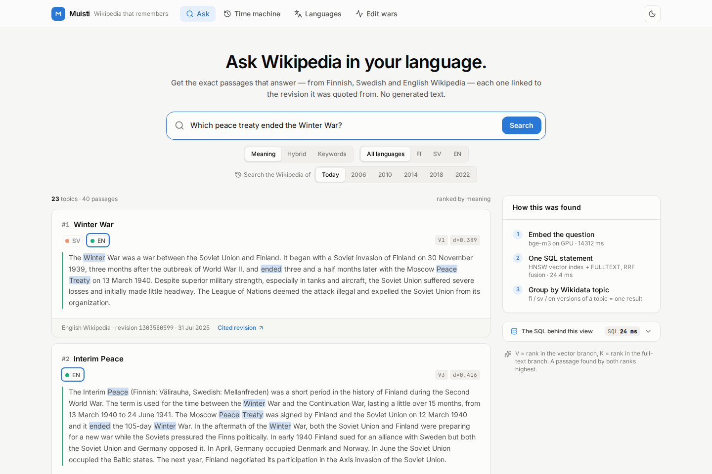
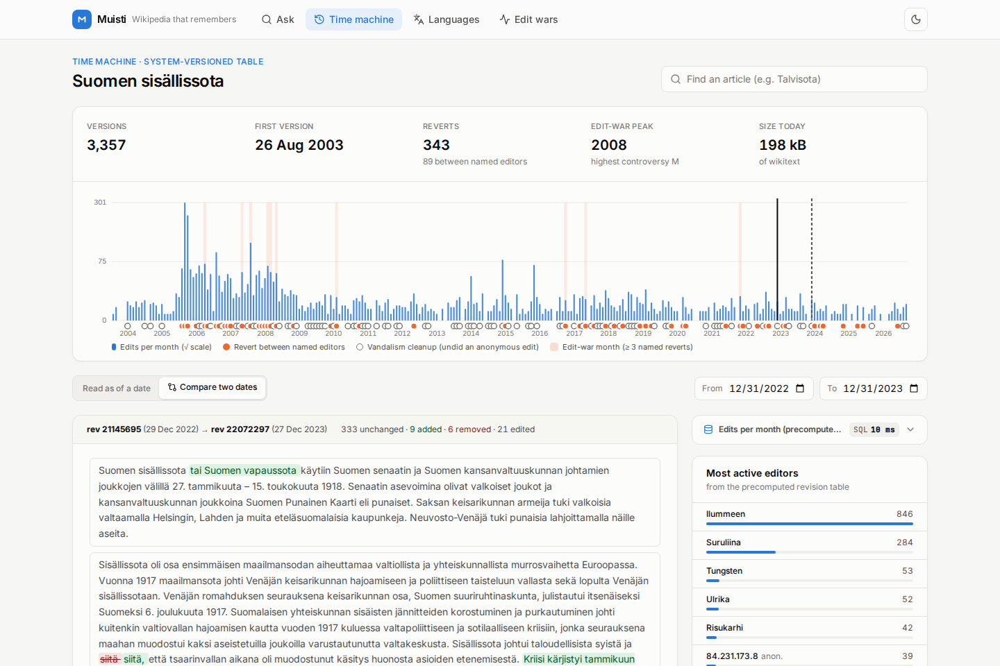
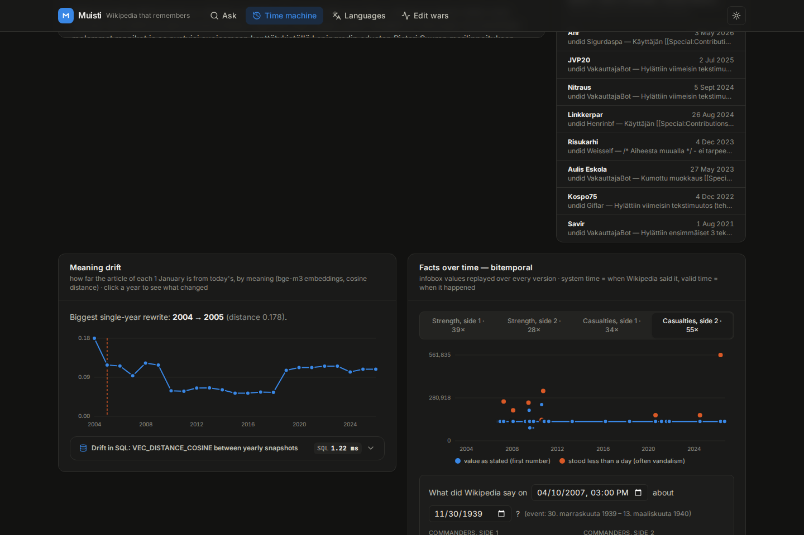
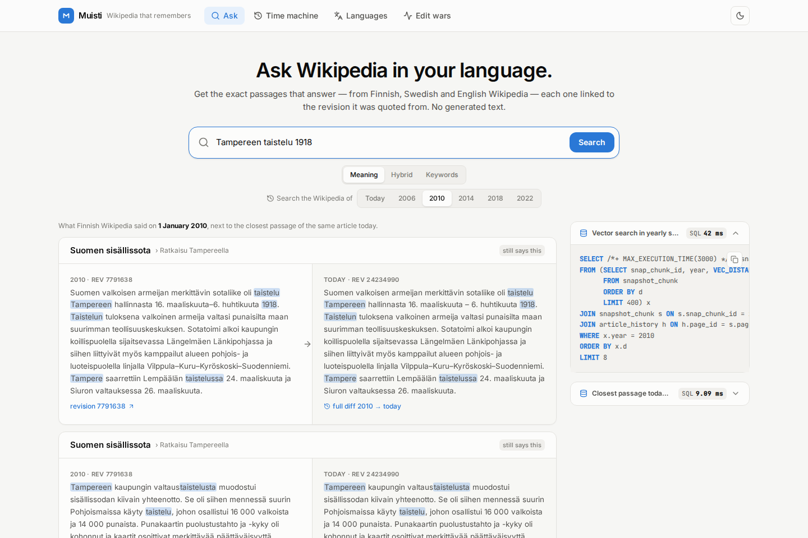
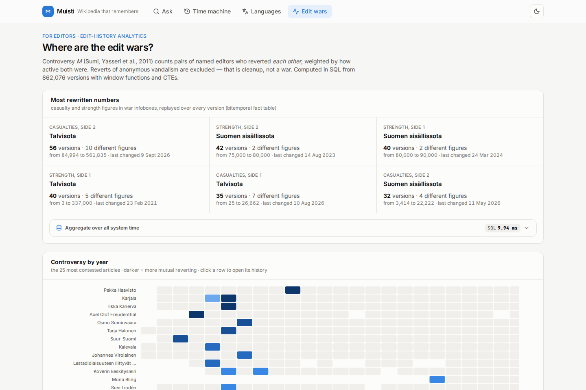

# Muisti — Wikipedia that remembers

> **Status:** built, loaded with all three official datasets, measured and tested (36 tests passing, see *Tests*).
> MariaDB **12.3.3** (Docker `mariadb:12.3`). Junction 2026 — MariaDB challenge, tracks **RAG + SVT (“BOTH”)**.

Ask a question in any language and get the **exact passages** that answer it — from Finnish, Swedish and
English Wikipedia — each linked to the revision it was quoted from. Then travel in time: read any article as it
stood on any day since 2003, see where editors fought, how its *meaning* drifted, which numbers were rewritten
— and ask **bitemporal** questions such as *“what did Wikipedia say on 10 April 2007 about January 1940?”*.

Everything runs in **one MariaDB database**: vector index, system-versioned tables, application-time periods,
full-text search, window functions and recursive CTEs. The SQL behind every view is shown in the UI with its
execution time.



| | |
|---|---|
|  |  |
|  |  |

## What we found (real data, reproducible)

- **Passages beat whole articles.** On the 37 official test questions of `mariadb-vector-wikipedia-rag`, our
  passage vectors find the answer in the top 5 for **81 %** of questions (starter design: 76 %, which we
  reproduce exactly on the same data), and hybrid search reaches **92 % in the top 10** (starter: 86 %).
  → [perf/EVAL.md](perf/EVAL.md)
- **Hybrid is not free.** Equal-weight RRF *lowered* top-5 to 70 %: stemmed full-text alone scores 32 % on these
  descriptive questions. A weighted RRF (full-text × 0.35), chosen by a sweep, gives the best top-10. The UI
  defaults to *Meaning* (best top-1/top-5) and offers *Hybrid* (best top-10).
- **The Winter War’s Soviet casualty figure was stated 56 different ways.** On 10 April 2007 at 15:00 the
  article said **256,875** dead; an hour earlier and after, **126,875**. In January 2008 a vandal set the Soviet
  strength to “2 unfortunate men, 0 tanks”, corrected within the hour. The bitemporal `fact` table answers this
  in one query (`FOR SYSTEM_TIME AS OF` × application period).
- **The 1918 article briefly gained a second name.** In 2023 the first sentence of *Suomen sisällissota* became
  “Suomen sisällissota **tai Suomen vapaussota**” (civil war *or war of liberation*); it was removed in 2024.
  (The article has been titled *sisällissota* since 2003 — the popular story that it was renamed is not in the data.)
- **Edit wars track real events.** Controversy *M* (Sumi, Yasseri et al. 2011), computed in SQL over all 862,076
  versions, ranks *Pekka Haavisto* in **2012** first — the year of his presidential candidacy — and
  *Ilkka Kanerva* in **2008**. Of 45,668 reverts, only 13,211 are named editors undoing each other; the rest is
  vandalism cleanup.
- **The AI and Wikipedia disagree — and you can see where.** Asked about the 1918 prison camps, Claude
  (from memory, no sources) says “most camps closed by the end of 1918”; the passage retrieved from MariaDB
  says Hennala closed on 1 October 1919. Each claim of the AI is shown as confirmed, contradicted or not
  found, with the Wikipedia revision it was checked against.
- **Edit wars are about specific words.** The top war (*Pekka Haavisto*, January 2012, during his
  presidential campaign) was over his partner’s birth date “28. heinäkuuta” — added and removed 9 times in two
  days. On *Karjala* (2008) it was “pakkoluovutti” (*forcibly* ceded) vs “luovutti” (ceded).
- **Wikipedia disagrees with itself.** Checked on demand, *Suomen sisällissota* ends the civil war on
  15 May 1918 while *Itsenäisen Suomen historia* and *Suomen poliittinen historia* say 16 May 1918.
- **Each language edition has blind spots.** Matching every passage of the fi/sv/en articles on a topic by
  meaning: on *Talvisota*, Finnish-only content includes commemorative medals, ammunition stocks and the war in
  Finnish literature — absent from the Swedish and English articles.

## Features

| View | What it does | MariaDB |
|---|---|---|
| **Ask** | Cross-language passage search (fi/sv/en), grouped by Wikidata topic, every passage linked to `?oldid=` | `VECTOR(1024)`, HNSW `VECTOR INDEX M=16`, `VEC_DISTANCE_COSINE`, `FULLTEXT` on Snowball-stemmed text, weighted RRF in one statement |
| **Ask → Wikipedia of 2010** | Search what Finnish Wikipedia said on 1 January of a past year, next to today’s closest passage | vector index over yearly snapshots + exact per-article nearest passage |
| **Time machine** | Any article on any date, version by version; diff between two dates; edits/reverts timeline | `WITH SYSTEM VERSIONING`, real edit times via `system_versioning_insert_history`, `FOR SYSTEM_TIME AS OF / ALL`, partitions by year |
| **Facts over time** | Infobox values (casualties, strengths, commanders…) replayed over every version; bitemporal query | application-time `PERIOD FOR` + system versioning in one table, `WITHOUT OVERLAPS` |
| **Meaning drift** | Distance of each year’s article from today’s, biggest single-year rewrite | `VEC_DISTANCE_COSINE` between snapshot embeddings, in a self-join |
| **Languages** | What each language edition says that the others don’t | vectors of all passages of a topic in one query |
| **Where did this come from?** | Click a paragraph: the revision where its idea first appeared, even if reworded, and its first wording | binary search with `FOR SYSTEM_TIME` over `KEY timeline` + bge-m3 similarity |
| **Fact check → AI vs Wikipedia** | An LLM answers from memory; each claim is confirmed / contradicted / not found against Wikipedia passages | vector search per claim; Claude Sonnet (`claude-sonnet-5-5`, structured outputs) only judges against quoted passages |
| **Fact check → Wikipedia vs itself** | On demand, for any article: possible contradictions with other articles (fi/sv/en), both passages side by side | each passage's stored vector queries the HNSW index for the closest passages elsewhere (~70 ms for 30 passages); Claude Sonnet judges the pairs |
| **Edit wars** | The biggest wars and the exact words fought over (removed / put back, how many times, by whom, edit summaries); most rewritten numbers | window functions (`LAG`, `MIN OVER`), CTEs, each revert replayed from the versioned table |

## Quick start

Needs Docker, Python 3.12 with [uv](https://docs.astral.sh/uv/), Node 20+, the `gh` CLI, and ideally an NVIDIA GPU.

```bash
make up          # MariaDB 12.3 in Docker, port 3309, settings in infra/mariadb/muisti.cnf
make data        # datasets S, M, L from MariaDB's releases, SHA256-checked (~1 GB)
make all         # schema, loads, analytics, facts, embeddings, snapshots, tests, measurements
make api         # http://127.0.0.1:8000  (FastAPI)
make web         # http://127.0.0.1:5173  (React)
```

Every step is resumable and can be run on its own (`make load-m`, `make embed`, …).

## Architecture

```
 dataset S (fi/sv/en, now) ──► load_s ──► article · article_vector · chunk ──► embed_chunks (bge-m3, GPU) ──► chunk_vector
 dataset M (862k versions) ──► load_m ──► article_history  (SYSTEM VERSIONING, real edit times, yearly partitions)
                                              │
                                              ├─► db/analytics.sql ──► revision · edit_war_year · article_controversy
                                              ├─► facts ─────────────► fact  (bitemporal: PERIOD FOR valid_time + SYSTEM VERSIONING)
                                              └─► snapshots ─────────► snapshot · snapshot_chunk (vectors per year)
 dataset L (568k articles) ──► load_l ──► article_l (stemmed FULLTEXT at Wikipedia scale)

 React (Vite) ──/api──► FastAPI ──► MariaDB 12.3       one database, every query shown in the UI with its time
```

## Choices, and why

- **Passages, not whole articles.** One vector per article finds the topic, not the fact, and cut 290 long
  articles. 122,351 passages (~180 words, cut along headings, reference sections skipped) fix both, measurably.
- **Same model as the dataset.** bge-m3 via sentence-transformers (fp16, GPU) instead of Ollama: our vectors
  agree with dataset S’s ready-made vectors at **cosine ≥ 0.9997** (`tests/test_embeddings.py`).
- **Stemmed full-text.** InnoDB `FULLTEXT` has no stemming; a Snowball-stemmed copy (fi/sv/en) makes *Suomen /
  Suomessa / Suomeen* one term. It does not handle Finnish consonant gradation (*sota / sodan*) — the vector branch
  covers that.
- **Vectors outside the partitioned table.** MariaDB refuses a vector index on a partitioned table
  (`ERROR 1506`, tested), so yearly snapshot vectors live in their own table.
- **Bitemporal facts without an LLM.** Values are parsed from infobox templates in every version; the historical
  period is parsed from the infobox’s own date *as it was at that time*. Real data, no generated text.
- **Precompute what never changes.** History is immutable: reverts, edit-war metrics and per-article totals are
  computed once (2 min) instead of re-scanning 12 GB per request — the ranking query went from 672 ms to < 1 ms.
- **Extractive by design.** No generated summaries: WMF paused its AI summaries in 2025 after editors objected.
  Every sentence shown comes from a revision you can open.
- **MariaDB’s given settings.** `M=16`, `mhnsw_ef_search=80` (from the starter), `mhnsw_max_cache_size` raised from
  the 16 MB default so all vectors fit, `MAX_EXECUTION_TIME` hint on every user-triggered query.

## Numbers

Laptop: 12 cores, 15 GB RAM, RTX 4060 8 GB (thermally throttled). MariaDB 12.3.3 in Docker.

| Step | Result |
|---|---|
| Load S: 29,460 articles + vectors + categories + 122,351 passages | ~3 min |
| Embed 122,351 passages (bge-m3, fp16, GPU) | 43 min (~45 passages/s) |
| Load M: 862,076 versions, 12.2 GB wikitext, real edit times | 16 min |
| Analytics: revisions, reverts, controversy M (window functions + CTEs) | 2 min |
| Bitemporal facts: 286 war/battle articles, every version | 27 s → 4,484 fact rows |
| Load L: 568,416 articles, stemmed (C Snowball, 8 processes) + FULLTEXT | 3.5 min + 3.3 min index |
| Snapshots: 200 most edited articles × 23 years, embedded (doc + passages) | 21 min |

Query latencies, warm, measured from Python over 20–200 varied inputs (full table and every query’s
`ANALYZE FORMAT=JSON`: [perf/RESULTS.md](perf/RESULTS.md)):

| Query | p50 | p95 |
|---|---|---|
| Passage search, vector (HNSW over 122,351 vectors, reads 100 rows) | 22 ms | 52 ms |
| Passage search, hybrid (vector + stemmed FULLTEXT, weighted RRF, one statement) | 47 ms | 87 ms |
| Stemmed FULLTEXT on dataset L (568,416 articles) | 86 ms | 289 ms |
| `FOR SYSTEM_TIME AS OF` (random article × date, 862,076 versions, incl. text) | 3.4 ms | 11 ms |
| Edits-per-month timeline | 1.3 ms | 2.3 ms |
| Controversy ranking (precomputed) | 0.7 ms | 1.1 ms |

Server-side, `ANALYZE` shows the vector branch reading exactly 100 rows from the HNSW index, and `AS OF` on a 2005
date reading 1 row via `KEY timeline (page_id, row_start, …)` in 0.2 ms. Measured while other workloads shared
the laptop’s 15 GB (swap full), so treat the p95 as pessimistic.

## Tests

```bash
make test        # 36 tests against the real database
```

Unit tests (stemming, chunking limits, wikitext cleaning, injection-safe full-text queries), embedding agreement
with the dataset, and end-to-end API tests on real data: cross-language search, revision links, `AS OF`
correctness, 404/422 handling, the 2023 lead change, the April 2007 casualty figure, cross-language gaps, drift.

## Limits

- Vectors for dataset L (568k articles) are not computed — days of GPU on a laptop; L demonstrates full-text scale.
- Snapshots are embedded for the 200 most edited articles (yearly), not all 19,742.
- The cross-language threshold (0.40) is calibrated on one topic; it ranks blind spots, it does not prove absence.
- Controversy *M* counts mutual reverts by user name; since 2025 anonymous editors appear as temporary accounts.
- *Where did this come from?* assumes an idea, once added, stays; an idea removed and re-added later is dated
  from its last continuous appearance.
- The fact checks need `ANTHROPIC_API_KEY` in `.env` (Claude Sonnet; ~15–20 s per check, cached per question/article); flagged contradictions are candidates for an editor to review; its verdicts are only as good as the
  five passages retrieved per claim — “not found” means “not in those passages”.

## Credits and licence

Data: Finnish, Swedish and English Wikipedia (CC BY-SA 4.0) via MariaDB’s
[datasets](https://github.com/MariaDB/mariadb-wikipedia-datasets). Built on MariaDB’s
[RAG](https://github.com/MariaDB/mariadb-vector-wikipedia-rag) and
[time machine](https://github.com/MariaDB/mariadb-system-versioning-wikipedia) examples (MIT): test questions,
index settings, the wikitext cleaner. Code: MIT. Text and vectors derived from Wikipedia: CC BY-SA 4.0.
