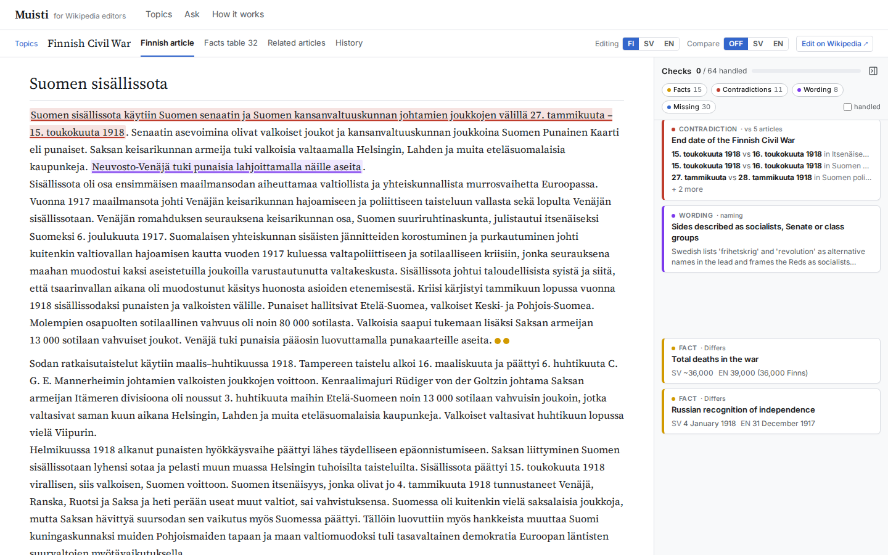
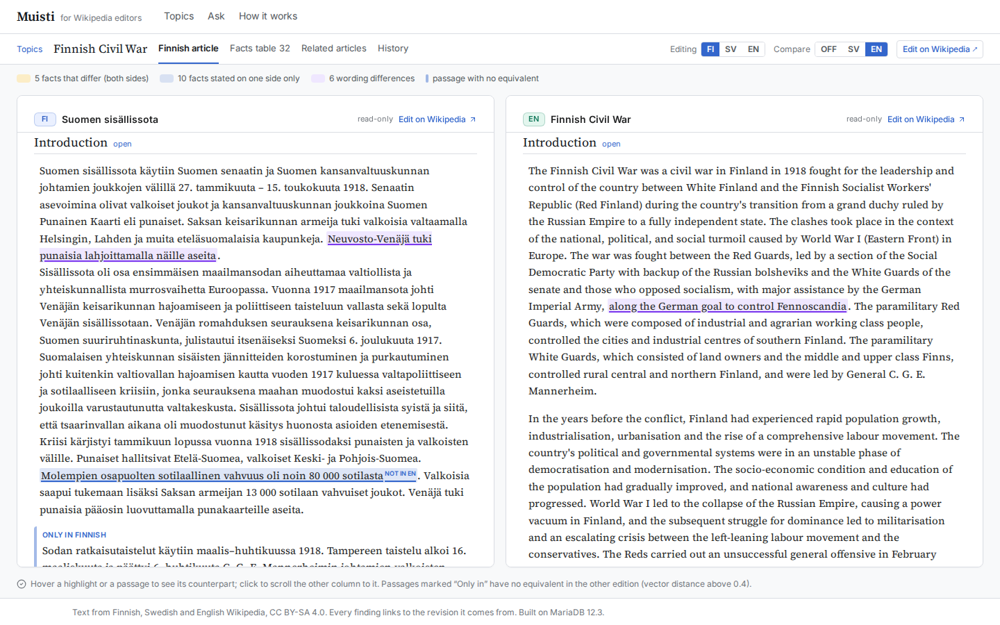
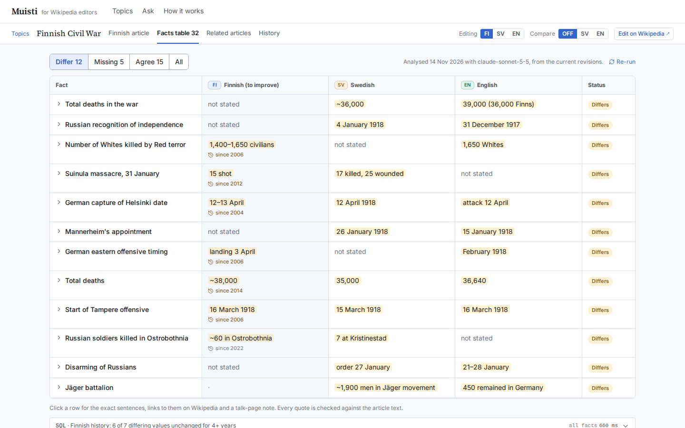
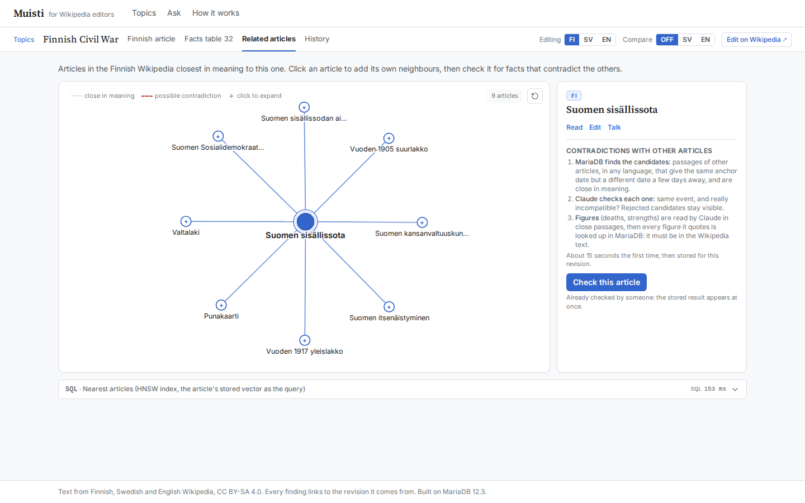
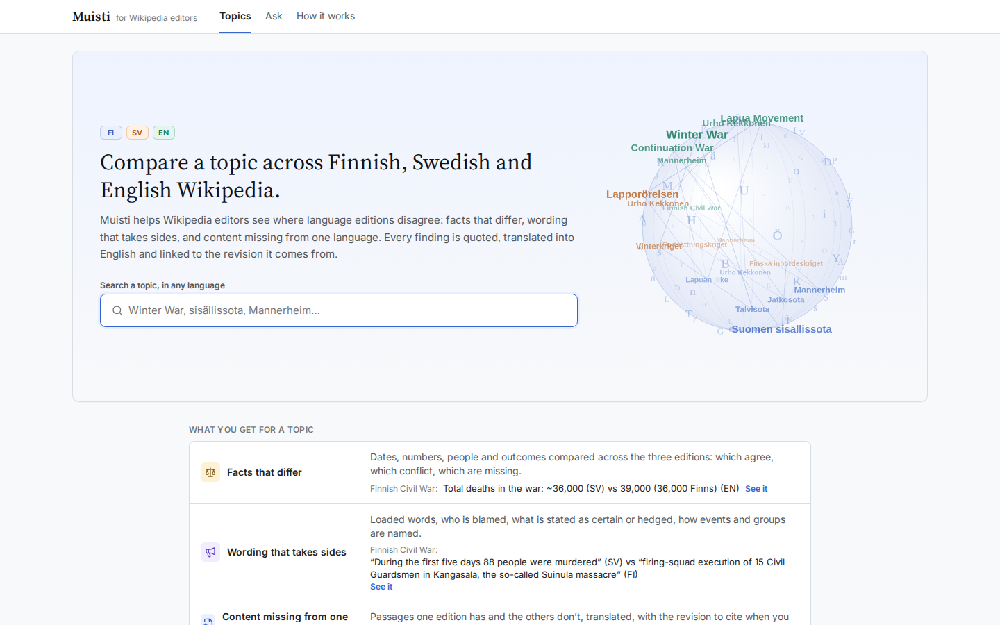

# Muisti: Wikipedia that remembers, for the editors who write it

> **Live demo:** https://16-170-90-24.sslip.io (until the end of Junction 2026)
> **Status:** built, loaded with all three official datasets, deployed, 50 tests passing (see *Tests*).
> MariaDB **12.3.3** (Docker `mariadb:12.3`). Junction 2026, MariaDB challenge, tracks **RAG + SVT ("BOTH")**.

A Wikipedia editor opens a topic, for example *Suomen sisällissota* (Finnish Civil War), and sees **their own
article's text with every problem highlighted in the sentence where it occurs**:
- a fact the Swedish or English article states differently;
- a date that contradicts another Wikipedia article;
- wording that takes sides;
- content the other editions have and this one lacks;
- a figure that has gone unchanged for years while the other editions moved on.

Each problem is a card in the margin, facing its sentence, with the exact quotes from every edition. The editor
marks it *fixed* or *not a problem*, and that decision is kept in a **system-versioned MariaDB table**.

Everything runs in **one MariaDB database**: vector index, system-versioned tables, application-time periods,
full-text search, window functions and recursive CTEs. Claude Sonnet is used only where judgement is needed. It
always works on passages that SQL has selected, and every quote or figure it returns is checked against the
Wikipedia text in MariaDB.



| | |
|---|---|
|  |  |
|  |  |

## The editor's workflow

| Step | What the editor sees | How it is computed |
|---|---|---|
| **Article** (default tab) | Full text of the edition they edit. Problems are highlighted in the exact sentence, and margin cards are aligned with their sentence. Filter chips (Facts, Contradictions, Wording, Missing) show a count, with progress "n / N handled". Each card can be marked *Fixed* or *Not a problem*. | Quotes are located in the passage text. Statuses go in `issue_status` `WITH SYSTEM VERSIONING`, so who dismissed what and when stays queryable (`FOR SYSTEM_TIME ALL`). |
| **Compare** (FI / SV / EN switch) | Two read-only columns, aligned passage by passage. A fact that differs is highlighted **on both sides**. A fact one edition leaves out is highlighted **only on the side that states it** ("not in en"). Wording differences appear on both sides, and passages with no equivalent carry an "Only in Finnish" band. Hovering a highlight lights up its counterpart; clicking scrolls the other column to it. | Passage alignment from the stored passage vectors (`VEC_DISTANCE_COSINE`). Highlights come from the stored analyses, so this mode makes no new AI call. |
| **Facts table** | Every fact compared across the three editions (32 on the Finnish Civil War): differ, missing, agree. Every value is checked in SQL. For Finnish, "since 2014" shows how long the value has stood, with the edit that introduced it. | Claude extracts the facts from aligned passages; each figure and date is looked up in `chunk_number` / `chunk_date`. The age of a value is traced through the 862,076 revisions of the system-versioned history. |
| **Related articles** | A map of the closest articles by meaning. Clicking an article adds its own neighbours. **Nothing is red until the editor clicks "Check this article"**: the stored result appears at once if someone already ran it, otherwise Claude checks it in about 15 s. | HNSW search on whole-article vectors. Contradictions are found in two ways. Dates: SQL finds candidates (same anchor date, another date 1 to 15 days apart, close in meaning), then Claude judges each one. Figures: Claude reads SQL-preselected pairs, then SQL verifies every figure it quotes. Results are stored per article revision. |
| **History** | How the Finnish article changed: edits, reverts, who changed a value and when. | `FOR SYSTEM_TIME AS OF / ALL` on `article_history`, precomputed `revision` table. |
| **Edit on Wikipedia** | Links that open the real editor at the right section. Wikipedia cannot be embedded (`X-Frame-Options: DENY`). | |

## What it finds (real data, reproducible)

On *Suomen sisällissota*, the Finnish article gets **64 checks**: 15 facts, 11 contradictions with other articles,
8 wording differences and 30 passages missing compared with the other editions.

- **The three editions disagree on the death toll.** Swedish: about 36,000. English: 39,000 (36,000 Finns).
  Finnish: about 38,000. The Finnish figure was changed from 37,000 to 38,000 on 8 December 2014 by an anonymous
  editor, and has stood since then.
- **Wikipedia disagrees with itself.** *Suomen sisällissota* ends the war on 15 May 1918, while
  *Itsenäisen Suomen historia* and *Suomen poliittinen historia* say 16 May 1918. On this article, 11 of the 18
  candidates were kept (8 dates, 3 figures). The 7 rejected ones stay visible with Claude's reason.
- **Russia's recognition of Finnish independence**: 4 January 1918 in Swedish, 31 December 1917 in English, not
  stated in Finnish.
- **Wording that takes sides.** Swedish says 88 people were "murdered" during the first five days. Finnish
  describes the Suinula events as the "firing-squad execution of 15 Civil Guardsmen", the so-called Suinula massacre.
- **Each edition has blind spots.** On *Talvisota*, Finnish-only content includes commemorative medals,
  ammunition stocks and the war in Finnish literature, all absent from the Swedish and English articles.
- **The Winter War's Soviet casualty figure was stated 56 different ways.** On 10 April 2007 at 15:00 the article
  said **256,875** dead; an hour earlier and after, **126,875**. The bitemporal `fact` table answers this in one
  query (`FOR SYSTEM_TIME AS OF` × application period).
- **Edit wars track real events.** Controversy *M* (Sumi, Yasseri et al. 2011), computed in SQL over all
  862,076 versions, ranks *Pekka Haavisto* in **2012** first, the year of his presidential candidacy.

## Where MariaDB does the work

| Need | MariaDB feature |
|---|---|
| Align passages across fi / sv / en, find related articles, find candidate contradictions | `VECTOR(1024)`, HNSW `VECTOR INDEX M=16 DISTANCE=cosine`, `VEC_DISTANCE_COSINE` |
| Check that a figure or date quoted by the AI is really in the text | indexed `chunk_number` / `chunk_date` tables, plain lookups |
| How long a value has stood, who changed it | `WITH SYSTEM VERSIONING` (real edit times via `system_versioning_insert_history`), `revision` table |
| Editor decisions with an audit trail | `issue_status WITH SYSTEM VERSIONING`, `FOR SYSTEM_TIME ALL` |
| Facts over time (casualties, strengths) | application-time `PERIOD FOR` + system versioning in one table, `WITHOUT OVERLAPS` |
| Cross-language search | vector + Snowball-stemmed `FULLTEXT`, weighted RRF in one statement |
| Edit wars, reverts | window functions (`LAG`, `MIN OVER`), CTEs |
| AI results stored once, shared by every editor | `analysis` table keyed by topic and article revisions, JSON results |
| Guard rails | `MAX_EXECUTION_TIME` hint on every user-triggered query |

The SQL behind each view is shown in the UI with its execution time.

## Also in the app

Reached from **Ask** and **How it works**, or by URL:
- **Ask**: cross-language passage search, every passage linked to `?oldid=`.
- **Time machine** (`/time`): any Finnish article on any date since 2003, with diffs.
- **Edit wars** (`/radar`): the biggest wars and the words fought over.
- **Languages** (`/languages`): what each edition says that the others don't.
- **Fact check** (`/check`): an AI answer checked claim by claim against Wikipedia.

## Quick start

Needs Docker, Python 3.12 with [uv](https://docs.astral.sh/uv/), Node 20+, the `gh` CLI, and ideally an NVIDIA GPU.

```bash
make up          # MariaDB 12.3 in Docker, port 3309, settings in infra/mariadb/muisti.cnf
make data        # datasets S, M, L from MariaDB's releases, SHA256-checked (~1 GB)
make all         # schema, loads, analytics, facts, embeddings, snapshots, tests, measurements
make api         # http://127.0.0.1:8000  (FastAPI)
make web         # http://127.0.0.1:5173  (React)
```

Every step is resumable and can be run on its own (`make load-m`, `make embed`, …). The AI checks need
`ANTHROPIC_API_KEY` in `.env`.

### Deployment (the live demo)

`deploy/` runs the whole stack on one 8 GB server (AWS `m7i-flex.large`): MariaDB, the API (FastAPI + bge-m3 on
CPU) and Caddy (static frontend, automatic HTTPS).

```bash
deploy/copy-db.sh ubuntu@HOST key.pem     # copy the MariaDB volume once (13 GB, streamed over SSH)
deploy/update.sh [web|api]                # ship the last commit, rebuild only what changed (8 s for an API change)
```

The live demo limits AI requests per IP (`AI_REQUESTS_PER_HOUR`, default 30). When the Anthropic credit runs out,
the API returns a clear message, and every stored result stays available.

## Architecture

```
 dataset S (fi/sv/en, now) ──► article · article_vector · chunk ──► bge-m3 (GPU) ──► chunk_vector
                                          └─► chunk_number · chunk_date   (figures and dates, for SQL checks)
 dataset M (862k versions) ──► article_history  (SYSTEM VERSIONING, real edit times, yearly partitions)
                                          ├─► revision · edit_war_year · article_controversy
                                          ├─► fact  (bitemporal: PERIOD FOR valid_time + SYSTEM VERSIONING)
                                          └─► snapshot · snapshot_chunk (vectors per year)
 dataset L (568k articles) ──► article_l (stemmed FULLTEXT at Wikipedia scale)

 Claude Sonnet ◄── passages selected in SQL      results ──► analysis (per revision)    decisions ──► issue_status (SVT)

 React (Vite) ──/api──► FastAPI ──► MariaDB 12.3       one database, every query shown in the UI with its time
```

## Choices, and why

- **The editor's text first.** Jury feedback: editors work in their article, not in dashboards. The default view is
  the article itself, with problems in place and checks in a side panel.
- **SQL selects, Claude judges, SQL verifies.** Claude never searches the corpus. It gets candidate passages
  chosen in SQL, and every quote must be found verbatim in the passage and every figure in `chunk_number`.
  Rejected candidates stay visible with the reason.
- **No dictionaries built by the LLM.** Wording differences are judged on quoted passages, not on generated word lists.
- **Pay once, share with everyone.** AI results are stored per article revision. The next editor gets them at once,
  and they are recomputed only when the article changes. Precomputing the six demo topics cost about $3.51.
- **Nothing alarming before the editor asks.** On the related-articles map, contradictions appear only after the
  editor clicks *Check*.
- **Passages, not whole articles.** 122,351 passages (~180 words, cut along headings) find the fact, not just the
  topic: 81 % of the starter's test questions answered in the top 5, against 76 % for one vector per article
  ([perf/EVAL.md](perf/EVAL.md)).
- **Same model as the dataset.** bge-m3: our vectors agree with dataset S's ready-made vectors at
  **cosine ≥ 0.9997** (`tests/test_embeddings.py`).
- **Precompute what never changes.** History is immutable: reverts, edit-war metrics and per-article totals are
  computed once. The ranking query went from 672 ms to < 1 ms.
- **Measure, then index.** Each hot query was audited with `ANALYZE FORMAT=JSON`:
  - title search, moved to `article_controversy`: 171 ms → 0.6 ms;
  - edit-war list: 28.6 ms → 0.1 ms;
  - topic list: 221 ms → 79 ms;
  - "since when" lookups over the revision table: 354 ms → ~20 ms.

## Numbers

Laptop: 12 cores, 15 GB RAM, RTX 4060 8 GB. MariaDB 12.3.3 in Docker.

| Step | Result |
|---|---|
| Load S: 29,460 articles + vectors + categories + 122,351 passages | ~3 min |
| Embed 122,351 passages (bge-m3, fp16, GPU) | 43 min |
| Load M: 862,076 versions, 12.2 GB wikitext, real edit times | 16 min |
| Analytics: revisions, reverts, controversy M | 2 min |
| Load L: 568,416 articles, stemmed + FULLTEXT | 3.5 min + 3.3 min index |

Query latencies, warm, over 20 to 200 varied inputs (full table: [perf/RESULTS.md](perf/RESULTS.md)):

| Query | p50 | p95 |
|---|---|---|
| Passage search, vector (HNSW over 122,351 vectors) | 22 ms | 52 ms |
| Passage search, hybrid (vector + stemmed FULLTEXT, weighted RRF) | 47 ms | 87 ms |
| Stemmed FULLTEXT on dataset L (568,416 articles) | 86 ms | 289 ms |
| `FOR SYSTEM_TIME AS OF` (862,076 versions, incl. text) | 3.4 ms | 11 ms |
| Controversy ranking (precomputed) | 0.7 ms | 1.1 ms |

On the live server (2 vCPU, 8 GB, no GPU), a topic's whole editor workspace loads in about 0.5 s once warm. Search
takes about 2.6 s, most of it embedding the question on CPU.

## Tests

```bash
make test        # 50 tests against the real database
```

The tests cover:
- unit tests: stemming, chunking, wikitext cleaning, injection-safe full-text queries;
- embedding agreement with the dataset;
- SQL checks of figures and dates;
- date contradiction candidates and the age of stale facts;
- end-to-end API tests on real data.

## Limits

- Findings are leads for an editor to review, not verdicts. A "missing" passage means no close match was found
  (vector distance above 0.40), not proof of absence.
- AI checks take 15 to 40 s the first time for a topic, then they are instant. On the live demo they depend on the
  remaining Anthropic credit.
- History, and therefore "since when", exists for the Finnish articles only (dataset M).
- Vectors for dataset L (568k articles) are not computed: L demonstrates full-text scale.
- The real Wikipedia editor cannot be embedded; editing happens on Wikipedia through section links.

## Credits and licence

Data: Finnish, Swedish and English Wikipedia (CC BY-SA 4.0) via MariaDB's
[datasets](https://github.com/MariaDB/mariadb-wikipedia-datasets). Built on MariaDB's
[RAG](https://github.com/MariaDB/mariadb-vector-wikipedia-rag) and
[time machine](https://github.com/MariaDB/mariadb-system-versioning-wikipedia) examples (MIT): test questions,
index settings, the wikitext cleaner. Code: MIT. Text and vectors derived from Wikipedia: CC BY-SA 4.0.
